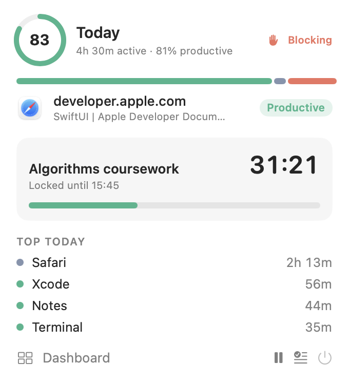
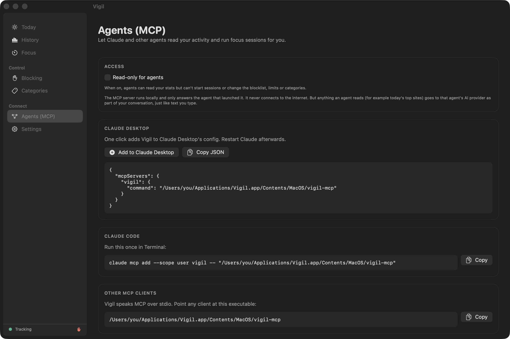
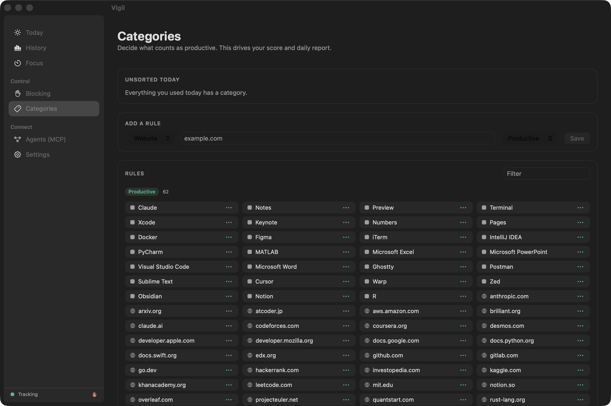
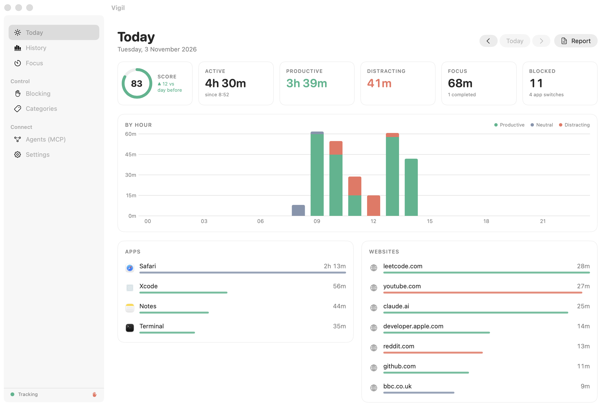

<p align="center">
  
</p>

<h1 align="center">Vigil Tracker</h1>

<p align="center">
  <b>See where your time really goes on your Mac, block what steals it, and let your AI agent coach you.</b><br>
  A native, offline macOS menu-bar app: activity tracking, Freedom/Cold Turkey-style blocking, daily reports and a built-in MCP server.
</p>

<p align="center">
  
  
  
  
  
</p>

<p align="center">
  
</p>

---

## Install in one line

```bash
curl -fsSL https://raw.githubusercontent.com/yehawashia/Vigil-Tracker/main/install.sh | bash
```

The installer builds Vigil from source on your Mac, so no pre-compiled binary is downloaded and Gatekeeper won't complain. It installs `~/Applications/Vigil.app` and sets it to run 24/7. You need macOS 13 or later; if Apple's command line tools are missing, the installer offers to install them.

Then click the 👁 in your menu bar → **Dashboard** → **Settings**:
1. Grant **Accessibility** so Vigil can read window titles.
2. Click **Test open browsers** and allow each **Automation** prompt so it can see and block websites.

<details>
<summary>Prefer to do it by hand?</summary>

```bash
git clone https://github.com/yehawashia/Vigil-Tracker.git
cd Vigil-Tracker
./build.sh --install
```
</details>

## Features

<table>
<tr>
<td width="50%" valign="top">

### 📊 Tracks everything, locally
- Frontmost app, window title and **website + time on site** in Safari, Chrome, Arc, Brave, Edge, Vivaldi, Opera and Chromium
- Event-driven, so app and tab switches register in about 0.1 s
- Idle, sleep, screen lock and user switching aren't counted
- Each app and site is productive, neutral or distracting, combined into a **0–100 score**. Right-click anything to recategorise it.

</td>
<td width="50%" valign="top">

### 🛑 Blocks distractions
- **Focus sessions** (25/50/90 min or any length) enforce your blocklist
- **Locked sessions** can't be stopped or quit until they end, and a force-quit just restarts Vigil
- **Schedules**, e.g. weekdays 09:00–12:00
- **Daily limits**, e.g. YouTube 30 min a day, then blocked until midnight
- Every open tab in every supported browser is checked, and blocked apps are quit

</td>
</tr>
<tr>
<td valign="top">

### 📬 Daily productivity update
- A notification at a time you choose: score, productive vs distracting time, biggest distraction
- A Markdown report with insights: best hour, distraction peaks, context switching, day-on-day change
- 7, 14 and 30-day history with trends

</td>
<td valign="top">

### 🤖 Built for AI agents (MCP)
- 15 tools: summaries, timelines, search, focus sessions, blocklist, limits, categories
- Add it to Claude Desktop with one click, or one command for Claude Code
- Read-only mode, and locked sessions that agents can't weaken
- See [AGENTS.md](AGENTS.md)

</td>
</tr>
</table>

## Screenshots

<p align="center">
  
  &nbsp;&nbsp;
  
</p>

| History | Focus |
|---|---|
|  |  |
| **Blocking** | **Agents (MCP)** |
|  |  |
| **Categories** | **Light mode** |
|  |  |

<sub>These are real captures of the app, made with `./build.sh --screenshots`, which fills it with generated sample data rather than anyone's actual activity.</sub>

## Connect your AI agent

**Claude Code**
```bash
claude mcp add --scope user vigil -- ~/Applications/Vigil.app/Contents/MacOS/vigil-mcp
```

**Claude Desktop:** Dashboard → **Agents (MCP)** → **Add to Claude Desktop**, then restart Claude.

**Any MCP client:** run `~/Applications/Vigil.app/Contents/MacOS/vigil-mcp` over stdio.

Things to try:
> *"How productive was I this week, and what was my worst day?"*
> *"What distracted me most yesterday afternoon?"*
> *"Start a locked 90-minute focus session for my algorithms coursework."*
> *"Limit Reddit to 20 minutes a day."*

The full tool reference is in [AGENTS.md](AGENTS.md).

## Privacy and security

Vigil records sensitive information, so it's built to keep it on your Mac:

- **No network code at all:** no accounts, analytics, update checks or cloud. It works the same offline.
- **Private files:** the data folder is `0700` and the SQLite files are `0600`. `secure_delete` overwrites deleted rows.
- **Trimmed URLs:** query strings, fragments and embedded logins are removed before saving (`site.com/watch`, not `?v=…&token=…`).
- **Retention:** old activity is deleted automatically (180 days by default; you can choose 30 days, 90 days, 1 year or forever).
- **Hardened runtime**, with Apple Events as its only entitlement.
- **Agent access is under your control:** stdio only, no ports, an optional read-only mode, and locked sessions can't be weakened.

More detail is in [SECURITY.md](SECURITY.md). One thing to know: anything an agent reads through MCP becomes part of your conversation with that agent's AI provider.

## Performance

Vigil runs constantly, so it's built to be cheap:

| | |
|---|---|
| App and tab switches | Picked up straight from NSWorkspace and Accessibility observers, ~0.1 s |
| Heartbeat | 1 s, with 0.2 s timer tolerance. Uses cached title, URL and settings, so no database reads in the common case |
| Database writes | One insert per new segment; the open segment is saved every 5 s |
| Browser AppleScript | Only runs when an event says the tab changed, with a 3 s fallback |
| Config sync with agents | `PRAGMA data_version`: reloads only when the MCP server actually wrote something |
| Summaries | Worked out on a background queue with a separate read connection |
| Background | Opted out of App Nap; doesn't stop your Mac sleeping |
| Always on | LaunchAgent with `KeepAlive`, restarted within 5 s if it stops |

## Everyday commands

```bash
./build.sh                # build build/Vigil.app
./build.sh --install      # (re)install to ~/Applications and run 24/7
./build.sh --run          # build and open without installing
./build.sh --screenshots  # regenerate docs/screenshots with sample data
UNIVERSAL=1 ./build.sh --zip   # Apple silicon + Intel build, zipped
./uninstall.sh            # remove the app and the background service (add --purge to delete data)
```

To pause Vigil until your next login, click ⏻ in the menu. To turn off 24/7 mode, go to **Settings → Always on → Turn off**.

## Project layout

```
Sources/VigilCore/   SQLite store, categoriser, summaries and reports (shared)
Sources/Vigil/       Menu-bar app: tracker, browser bridge, blocker, notifications, SwiftUI views
Sources/VigilMCP/    stdio MCP server (JSON-RPC 2.0)
Resources/           Info.plist, entitlements, icon
build.sh             build, sign, install, package
install.sh           one-line installer   ·   uninstall.sh
```

## Limitations

- Website blocking goes through browser automation, not the network. Firefox and Tor can't be controlled this way, so add them as **blocked apps** during sessions.
- An administrator can always remove a blocker. Locking protects you from yourself, not from someone with admin rights.
- Watching a video without touching the keyboard or mouse counts as idle after the threshold, which you can change in Settings.

## License

[MIT](LICENSE)
