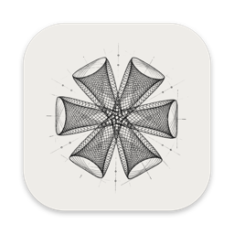
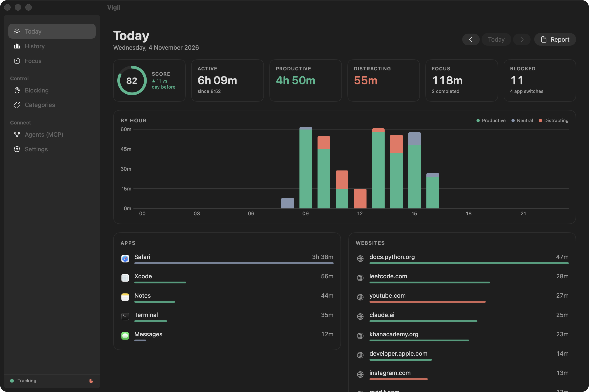
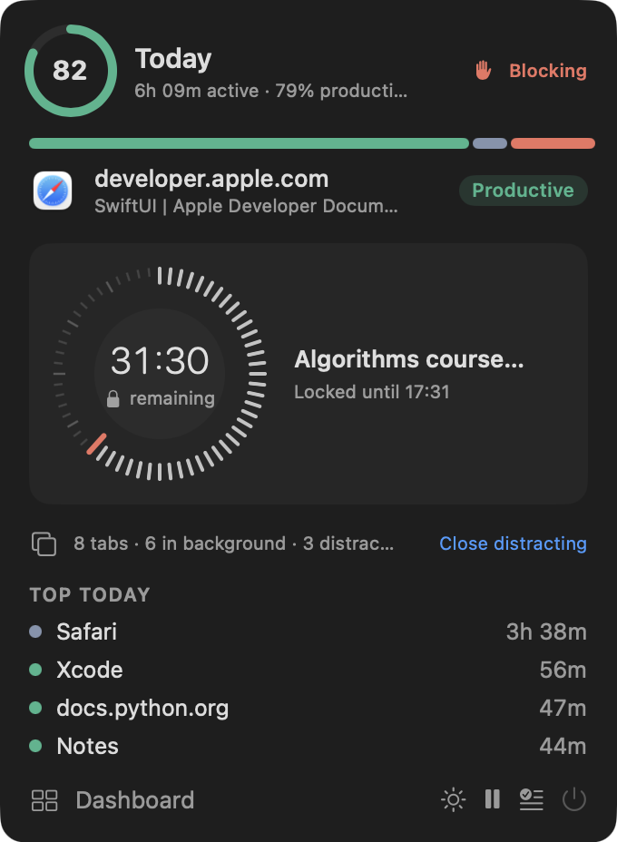
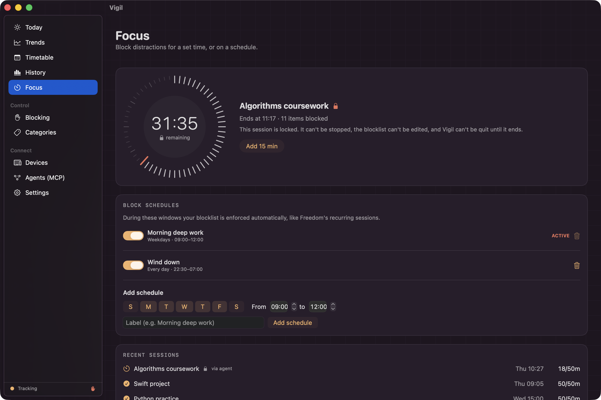
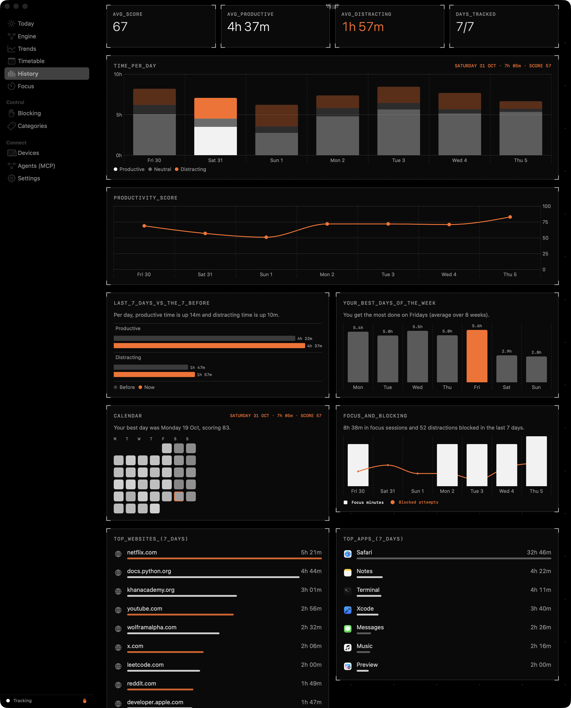
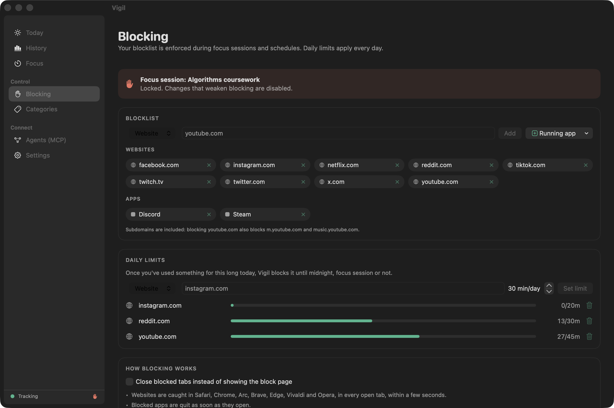

<p align="center">
  
</p>

<h1 align="center">Vigil Tracker</h1>

<p align="center">
  A simple activity monitor for your Mac that lets your AI agent access your productivity data.<br>
  It tracks your apps and websites, blocks distractions, and sends you a daily report. Everything stays on your Mac.
</p>

<p align="center">
  
  
  
  
</p>

<p align="center">
  
</p>

## What it does

- **Tracks** which app, window and website you're using, and for how long. Idle time doesn't count.
- **Scores** your day from 0 to 100, based on productive, neutral and distracting time.
- **Blocks** distracting sites and apps during focus sessions, on a schedule, or once you've hit a daily limit, like [Freedom](https://freedom.to) or [Cold Turkey](https://getcoldturkey.com).
- **Reports** your day with a notification each evening and a written summary.
- **Connects to AI agents** (Claude and other MCP clients), so you can ask *"How productive was I this week?"* or *"Block YouTube for the next hour."*

## Install

```bash
curl -fsSL https://raw.githubusercontent.com/yehawashia/Vigil-Tracker/main/install.sh | bash
```

Then click the **👁** in your menu bar → **Dashboard** → **Settings**, and:
1. Grant **Accessibility** so Vigil can see window titles.
2. Click **Test open browsers** and allow access so it can see and block websites.

You need macOS 13 or newer. The installer builds Vigil on your Mac from this source code and keeps it running in the background.

## Connect your AI agent

**Claude Code:**
```bash
claude mcp add --scope user vigil -- ~/Applications/Vigil.app/Contents/MacOS/vigil-mcp
```

**Claude Desktop:** Dashboard → **Agents (MCP)** → **Add to Claude Desktop**, then restart Claude.

Things to ask:
- "What distracted me most yesterday?"
- "Show my productivity trend for the last two weeks."
- "Start a 50-minute focus session for my coursework."
- "Limit Reddit to 20 minutes a day."

**Agents:** full setup steps and the tool reference are in [AGENTS.md](AGENTS.md).

## Screenshots

| Menu bar | Focus session |
|---|---|
|  |  |
| **History** | **Blocking** |
|  |  |

<sub>These screenshots show sample data, not real activity. Regenerate them with `./build.sh --screenshots`.</sub>

## Privacy

- **Nothing leaves your Mac.** Vigil has no internet code: no accounts, no analytics, no cloud.
- Your data is in one file only you can read: `~/Library/Application Support/Vigil/vigil.sqlite`.
- Web addresses are saved without search terms or tokens, and old data is deleted after 180 days. You can change both in Settings.
- Agents can be set to **read-only**, and can never end a locked focus session.

Details: [SECURITY.md](SECURITY.md)

## Uninstall

```bash
~/.vigil/src/uninstall.sh            # remove the app (keeps your data)
~/.vigil/src/uninstall.sh --purge    # remove the app and all data
```

## Build from source

```bash
git clone https://github.com/yehawashia/Vigil-Tracker.git && cd Vigil-Tracker
./build.sh --install
```

The code is plain Swift with no dependencies: `Sources/VigilCore` (storage and reports), `Sources/Vigil` (the app) and `Sources/VigilMCP` (the agent server). See [AGENTS.md](AGENTS.md#4-working-on-the-code) for the code layout and conventions.

## License

[MIT](LICENSE)
