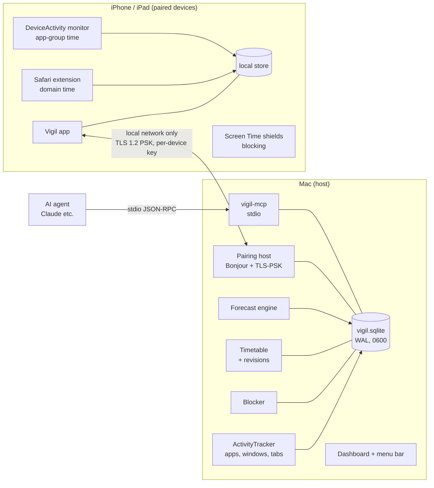
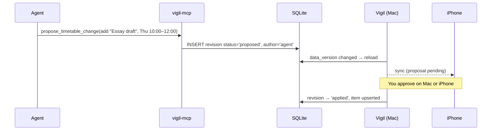

# Vigil architecture

Vigil is a personal time-tracking, blocking and planning system. A **Mac is the host**: it collects
activity, stores everything, runs predictions and serves AI agents. **iPhones and iPads are paired
devices**: they block distractions, run the timetable, measure their own Safari and app-group time,
and show everything the host knows.

Design goals, in priority order:

1. **Private by construction.** No internet code, no accounts, no servers. Devices talk only over the
   local network, only after pairing, and only encrypted.
2. **Light.** The host idles at ~0% CPU. Work happens on events, not polling. Charts are computed off
   the main thread and cached.
3. **Simple to use.** One dial to focus. One code to pair. One timeline to plan.
4. **Honest data.** Every number says where it came from (Mac, iPhone, iPad, agent) and how precise it is.

---

## 1. System overview



| Component | Where | Job |
|---|---|---|
| `VigilCore` | Mac + iOS | SQLite store, categoriser, reports, **forecasts**, **timetable model**, **sync messages** |
| `Vigil` | Mac | Tracking, blocking, dashboard, **pairing host**, **devices page** |
| `vigil-mcp` | Mac | Agent tools. Timetable changes from agents are **proposals** |
| `VigilMobile` | iOS / iPadOS | Focus dial, timetable, blocking, charts, pairing client |
| Safari extension | iOS / iPadOS | Time per website in Safari |
| DeviceActivity monitor | iOS / iPadOS | Time per user-defined app group, in 15-minute steps |

---

## 2. Data

All data lives in one SQLite database per device (`0600`, folder `0700`, WAL, `secure_delete`).
The host keeps everything; paired devices keep their own data plus a read-only cache of the host's.

### 2.1 Existing tables
`activity`, `rules`, `blocklist`, `limits`, `focus_sessions`, `schedules`, `block_events`, `settings`.

### 2.2 New tables (schema v3)

```sql
-- Timetable: the current state of each item.
CREATE TABLE timetable_items (
  id TEXT PRIMARY KEY,              -- UUID, stable across devices
  title TEXT NOT NULL,
  notes TEXT,
  start REAL NOT NULL,              -- unix seconds
  end REAL NOT NULL,
  kind TEXT NOT NULL,               -- 'task' | 'block' (time block that turns blocking on)
  done INTEGER NOT NULL DEFAULT 0,
  deleted INTEGER NOT NULL DEFAULT 0,
  revision INTEGER NOT NULL         -- id of the revision that produced this state
);

-- Version history: append-only. Every change, by anyone, is a row here.
CREATE TABLE timetable_revisions (
  id INTEGER PRIMARY KEY AUTOINCREMENT,
  item_id TEXT NOT NULL,
  op TEXT NOT NULL,                 -- 'create' | 'update' | 'delete' | 'revert'
  before TEXT,                      -- JSON snapshot (NULL for create)
  after TEXT,                       -- JSON snapshot (NULL for delete)
  author TEXT NOT NULL,             -- 'mac' | 'agent' | 'device:<id>'
  status TEXT NOT NULL,             -- 'applied' | 'proposed' | 'rejected'
  note TEXT,                        -- agent's reason, shown on approval
  time REAL NOT NULL
);

-- Paired devices. Keys live in the Keychain; this only references them.
CREATE TABLE devices (
  id TEXT PRIMARY KEY,              -- random 128-bit id issued at pairing
  name TEXT NOT NULL, model TEXT, platform TEXT,
  paired_at REAL NOT NULL, last_seen REAL,
  revoked INTEGER NOT NULL DEFAULT 0
);

-- What paired devices report. Idempotent: (device_id, day, kind, key) is unique.
CREATE TABLE device_usage (
  device_id TEXT NOT NULL,
  day TEXT NOT NULL,
  kind TEXT NOT NULL,               -- 'domain' | 'app_group' | 'focus'
  key TEXT NOT NULL,                -- domain, group name, or 'focus'
  seconds REAL NOT NULL,
  precision_seconds INTEGER NOT NULL, -- 1 for Safari/focus, 900 for app groups
  category TEXT,
  updated REAL NOT NULL,
  PRIMARY KEY (device_id, day, kind, key)
);
```

**Why revisions are append-only:** history can't be rewritten, so "who changed what" is always
answerable, and any change can be undone by applying its `before` snapshot as a new `revert` revision.
Reverting never deletes history.

---

## 3. Timetable and agents



- **Agents can only propose.** `propose_timetable_change` writes a `proposed` revision. Nothing
  changes until you approve it on the Mac or a paired device. Rejected proposals stay in history.
- **Agents connect over MCP (stdio), not a network port.** The agent launches `vigil-mcp` as a child
  process; there is no listening socket for an agent to reach, so nothing else on the network can.
  Read-only mode hides the proposal tool entirely.
- **Time blocks** (`kind = 'block'`) turn the blocklist on for their duration, like a one-off schedule.
  They are cached in memory like `schedules`, so the 1 s tick still never queries SQLite.
- Locked focus sessions are never weakened: a time block can extend blocking, never shorten it.

New MCP tools: `get_timetable(start_date?, end_date?)`, `propose_timetable_change(op, item…, reason)`,
`get_timetable_history(item_id?, limit?)`, `get_devices()`.

---

## 4. Pairing and sync security

### 4.1 Threat model

| Threat | Mitigation |
|---|---|
| Someone on the same Wi-Fi reads traffic | Every byte is TLS-encrypted with a per-device 256-bit key |
| Someone on the Wi-Fi pretends to be your Mac or phone | No key, no session: TLS-PSK fails without the shared secret |
| Someone photographs the QR code later | Pairing secrets are single-use and expire after 2 minutes |
| Someone watches the PIN pairing and intercepts it (man-in-the-middle) | PIN mode is numeric comparison over an ECDH exchange: an attacker in the middle produces a different code |
| A lost phone | Revoke it on the Mac: its key is deleted, and it can't reconnect |
| Data leaves the house | No internet code. Bonjour and the listener are local-network only (`requiredInterfaceType` excludes cellular; no port forwarding, no relay) |
| Malicious messages from a paired device | Strict `Codable` schemas, size limits (1 MB per message), parameterised SQL, and devices can only write their own `device_usage` rows and timetable revisions marked as theirs |

### 4.2 Pairing

The Mac shows a pairing screen with **both** options:

**QR code (recommended).** The Mac creates a one-time pairing secret (32 random bytes) and an
ephemeral X25519 key, and shows a QR code containing `vigil://pair?h=<host id>&k=<ephemeral public key>&s=<secret>`.
The QR is framed by an animated dot ring (Vigil's own design) so it's obvious the screen is live.

**PIN.** For when the camera can't see the screen. Both sides do an X25519 exchange, then each shows a
6-digit code derived from the exchange transcript. You confirm the codes match on the Mac. An attacker
in the middle would cause different codes.

```mermaid
sequenceDiagram
  participant P as iPhone
  participant M as Mac
  P->>M: hello(device id?, name, model, ephemeral pub Pe)
  M->>P: hello(host id, name, ephemeral pub Me)
  Note over P,M: shared = X25519(Pe, Me); transcript = SHA256(hellos)
  alt QR
    P->>M: proof = HMAC(secret from QR, transcript)
  else PIN
    Note over P,M: both show SAS = HKDF(shared, transcript) mod 10^6. You tap "Codes match" on the Mac.
  end
  M->>P: AES-GCM(key from HKDF(shared), {device id, device key K, host id, host name})
  Note over P,M: K (256-bit) is stored in each side's Keychain. Pairing secret is destroyed.
```

### 4.3 Everyday sync

- The Mac advertises `_vigil._tcp` over Bonjour **only while pairing or while it has paired devices**.
- Sessions use **TLS 1.2 with a pre-shared key** (Network.framework, the same approach as Apple's
  peer-to-peer sample). PSK identity = device id; PSK = that device's `K`. No certificates to manage,
  and a revoked device simply has no key.
- Messages are length-prefixed JSON (`SyncMessage` in `VigilCore`), max 1 MB each.
- Sync is **pull for host data, push for device data**, all idempotent:
  - Device → host: `usage(day, kind, key, seconds, precision)` upserts, timetable edits (applied,
    authored `device:<id>`), approvals of agent proposals, focus sessions started on the device.
  - Host → device: day summaries and history for charts, forecasts, timetable + pending proposals,
    blocklist, device list (so each device can show which host it's paired to).
- Both sides show connection state: the Mac's **Devices** page lists every device (name, model, last
  seen, data it sent, Revoke). The phone shows **Connected to "<Mac name>"** with the same last-seen time.

---

## 5. iPhone and iPad measurement (within Apple's rules)

| Signal | How | Precision | Needs |
|---|---|---|---|
| Websites (Safari) | Safari Web Extension reports the active tab's domain and time | to the second | Safari extension switched on by you; App Group (may need a paid account) |
| App groups | You pick apps into named groups ("Social", "Games"). A DeviceActivity monitor fires every 15 minutes of use per group | 15-minute steps | Family Controls (paid Apple Developer account) |
| Blocking | Screen Time shields on blocked apps, categories and websites during focus and time blocks | n/a | Family Controls (paid) |
| Focus sessions | The app's own dial and timer | to the second | nothing |

Apple does not let apps read exact per-app usage or send it off the device, so Vigil never claims to.
Charts mark 15-minute-step data as approximate.

---

## 6. Predictions

Forecasts run on device, in `VigilCore/Forecast.swift`, with no machine-learning framework:

- **Today's finish:** today so far + your typical remaining time for this weekday (median of the last
  4–8 same weekdays, by hour). Shown as a range (25th–75th percentile), not one number.
- **Next 7 days:** weekday-seasonal level with exponential smoothing (Holt, α = 0.3) over the last
  8 weeks of active, productive and distracting time, with an 80% band from past forecast errors.
- **Your rhythm:** average productive and distracting minutes for each hour, weekdays vs weekends,
  drawn as two curves (inspired by circadian charts).
- **Streaks and risk:** "you usually lose focus around 3pm on Thursdays", from the hourly profile.

Forecasts need at least 7 days of data; before that, the cards say so.

---

## 7. Visual system

| | Day (paper) | Night (plum) |
|---|---|---|
| Background | warm grey paper `#EEECE8` | deep plum `#1E1620` with a faint grid |
| Ink | near-black `#161616`, greys for secondary series | soft lavender `#C9B8D9` text |
| Accent | signal orange `#F26B2A` | amber `#F2B166` and coral `#E8735A` curves with gradient fills |
| Charts | monochrome ranks, lollipops, barcodes, dot matrices | glowing curves, gridlines, gradient areas |

Chart types: 90-day barcode (lollipops for daily active time), daily range (first to last activity),
rhythm curves, a 100-dot category matrix, a ranked app/site ring, forecast band.

---

## 8. Performance budget

| Path | Budget | How |
|---|---|---|
| Mac tick (1 s) | < 0.2 ms, no SQLite | In-memory caches; `PRAGMA data_version` only |
| App / tab switch → recorded | ~30 ms | Accessibility + NSWorkspace events, coalesced |
| Trends page | < 150 ms, off main thread | One grouped query per chart, cached by `data_version` |
| Sync | < 50 KB per sync typically | Only changed days and revisions since the last sync |
| iOS battery | No background polling | DeviceActivity events, Safari extension events, sync when the app opens or on change |

---

## 9. Build and delivery

- Mac: `./build.sh --install` (unchanged).
- iPhone/iPad: `iOS/Vigil.xcodeproj`, one universal app (iPhone + iPad layouts). Needs Xcode.
  Free Apple ID: install to your own devices; it must be reinstalled every 7 days. Blocking and app
  groups switch on automatically when the app has the Family Controls permission (paid account).
- Minimums: macOS 13, iOS/iPadOS 16.

## 10. Decision log

| # | Decision | Why | Rejected |
|---|---|---|---|
| 1 | Local network only | Keeps Vigil's "nothing leaves your Mac" promise | iCloud sync (would route data through Apple) |
| 2 | TLS-PSK with per-device keys | Standard TLS, no certificate handling, instant revoke | Self-signed certs (pinning UX), custom crypto transport |
| 3 | QR + numeric-comparison PIN | QR is fastest; PIN comparison resists interception without needing a PAKE library | Plain 6-digit PIN as the key (brute-forceable offline) |
| 4 | Agents propose, you approve | You asked for approval; avoids silent calendar edits | Direct agent writes |
| 5 | MCP over stdio for agents | No open port for anything else to reach | Local HTTP API (more attack surface) |
| 6 | Append-only revisions | Full history and safe revert | Overwriting rows, snapshots |
| 7 | App groups in 15-minute steps | The finest detail Apple allows to leave the Screen Time sandbox via thresholds | Claiming exact per-app times |
